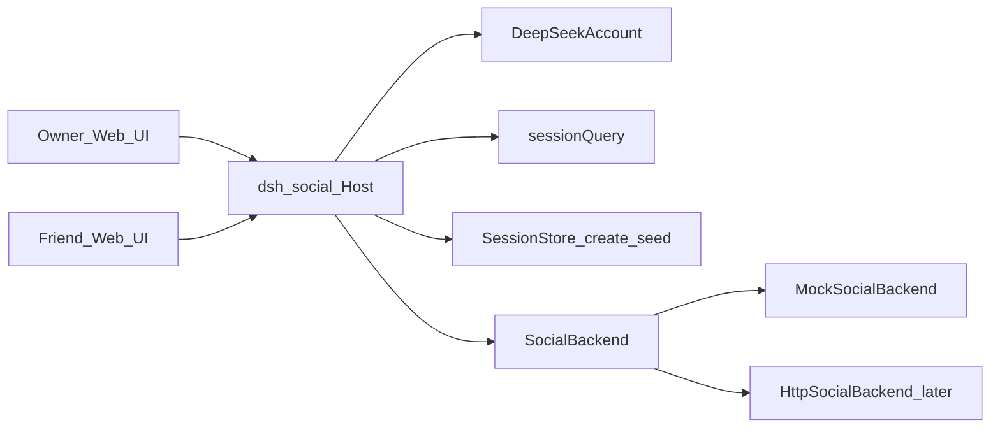

# 好友与只读会话分享 技术方案

> Feature：[999-social-friends-share](../BRIEF.md) | 有效需求来源：会话确认（A + 复用 DeepSeek 账号；无独立 PRD，AC 维护于本文「需求依据与验收」） | Profile：standard | 模板：[mai-specs/_templates/TECH_DESIGN.tmpl.md](../../_templates/TECH_DESIGN.tmpl.md) | 代码基线：`master` @ `39163dd30f` | 状态：草案（已按 [design_review](../review/design_review.md) 修订 P0/P1/P2）

## 需求依据与验收

**来源**：2026-11-16 会话确认产品内 MVP（选项 A）+ 复用 DeepSeek 账号；角色/点赞/实时对话窗口延后。本表为本 Feature 可判定 AC 的唯一维护位置，直至后补 PRD 迁入同等 ID。

**验收边界（产品条件）**：本阶段交付与 AC5 仅要求 **单 Host + `SocialBackend` Mock + 双 `AccountUserId` 测试夹具** 跑通 AC1–AC4。Mock 通过**不等于**多机/跨安装社交可用。跨安装真跨机以任务 T6（`HttpSocialBackend` + 平台 Social HTTP）为门禁；未完成 T6 前，README/插件文案须标明实验室 Mock。

| AC | 行为 | 判定 |
| --- | --- | --- |
| AC1 | 未登录 DeepSeek 账号时，社交入口引导登录，不调用 `SocialBackend` | 无 grant / 无 `AccountUserId` 时列表与分享操作被拒绝且 UI 进入登录 |
| AC2 | 已登录用户可向另一 `AccountUserId`（粘贴 id）发起好友请求；对方可接受或拒绝；双方好友列表可见 `FriendshipView`（peerId + 可选 name/avatarUrl） | Mock 夹具写入 peer 档案时可看到 name/avatar；无档案时至少可见 peerId |
| AC3 | 仅当双方为 `accepted` 好友时，分享者可对**本机选中 Session**创建只读快照分享并投递到对方收件箱 | 非好友返回权限错误；成功后收件箱出现一条 `share` |
| AC4 | 好友打开收件箱项后，以只读方式浏览该会话投影，且无法发起 `session/prompt` / 写入 | UI 隐藏发送；**Host 在 prompt 路径拒绝**（见 §2.3.2，不依赖 owner 的 remote-access 放行） |
| AC5 | 默认 Mock 下双账号夹具端到端跑通 AC1–AC4 | Host/Client 测试通过；不要求第二台机器 |

**不做范围**：角色权限体系、点赞、实时协同/直播对话窗、默认启用进 Web composition、用匿名 `anonymous-user-id` 建好友图、重做 Liveshare Relay、MVP 用户搜索 API（`searchUsers`）。

## 1. 方案概述

### 1.1 设计目标和设计原则

- 闭环：登录 → 粘贴对方账号 id 加好友 → 分享当前 Session 只读快照 → 好友收件箱打开只读浏览。
- 复用：[`DeepSeekAccount`](../../../packages/credentials/deepseek-account/README.md)；[`sessionQuery.readSession`](../../../packages/session-query/session-query/README.md)；分享前对齐 export 的 [`flushLiveSessionLog`](../../../packages/session-query/session-log-export/src/archive.ts)；导入复用 [`ctx.sessions.create(id, { seed, meta })`](../../../packages/core/session/README.md)。
- 与 [Liveshare](../../../packages/experimental/liveshare/README.md)：实时协作走 Liveshare；本 Feature 只做异步快照收件箱。
- 投放：`packages/experimental/` optional bundle，默认关闭。

### 1.2 整体架构



| 层 | 职责 | 拟新增位置 |
| --- | --- | --- |
| Client | 好友面板、分享入口、收件箱、只读打开 | `packages/experimental/client-ui-social/` |
| Host 服务 | 鉴权、flush+读 Session、导入 seed、只读拒绝、Remote | `packages/experimental/social/` |
| SocialBackend | 好友图、peer 档案缓存、收件箱、快照存取 | 接口与 Mock 同 Host 包 |
| Bundle | optional composition | `packages/experimental/social-bundle/` |

### 1.3 关键决策与 Review 索引

| 决策 | 推荐及理由 | 代价与备选 | 待判断事项/确认状态 | 详情 |
| ---- | ---------- | ---------- | ------------------- | ---- |
| 身份源 | 仅 DeepSeek `AccountUserId` | 无账号不可用 | 已确认 | 账号 README |
| 找好友 | MVP **删除 searchUsers**；Client 粘贴 peerId | 发现性差 | 已按评审钉死 | §2.1.3 |
| 分享物 | 提交后事件快照 | 非实时；附件后置 | 已确认 | §2.1 |
| 打开/导入 | `sessions.create` + 全量 seed；挂接收方**当前 Workspace** 的 `cwd` | 依赖已选 Workspace | 已按评审钉死 | §2.3.2 / [CODE_DESIGN](./CODE_DESIGN.md) |
| 只读强制 | Session 标记 + **prompt Host 闸门**（owner 也会拒）；UI 同步隐藏 | 不能只靠 remote-access（owner 恒放行） | 已钉死 | §2.3.2 |
| Backend 缝 | 接口 + 默认 Mock；HTTP=T6 | 双实现至云端就绪 | 跨机门禁已写清 | §2.2 |
| 附件 | 不传 blob | 缺图 | 后置 | AC |
| 投放 | experimental optional bundle | 不进默认产品 | 已确认 | experimental AGENTS |

供评审代码：[CODE_DESIGN.md](./CODE_DESIGN.md)。

## 2. 详细设计方案

### 2.1 核心结构设计

#### 2.1.1 数据结构设计

```ts
// 设计示意
type FriendshipStatus = 'pending_out' | 'pending_in' | 'accepted' | 'rejected'
/** listFriends / listPending 的 Client 视图：边 + Host 拼装的 peer 投影 */
interface FriendshipView {
  readonly peerId: AccountUserId
  readonly status: FriendshipStatus
  readonly updatedAt: number
  readonly name: string | null
  readonly avatarUrl: string | null
}
interface PeerProfile {
  readonly id: AccountUserId
  readonly name: string | null
  readonly avatarUrl: string | null
}
interface ShareSnapshotMeta {
  readonly shareId: Branded<'SocialShareId'>
  readonly fromId: AccountUserId
  readonly toId: AccountUserId
  readonly title: string
  readonly createdAt: number
  readonly format: 'session-events-v1'
}
interface ShareSnapshotPayload extends ShareSnapshotMeta {
  readonly sessionFormatVersion: number
  readonly events: readonly SessionEvent[]
}
interface InboxItem {
  readonly shareId: ShareSnapshotMeta['shareId']
  readonly from: PeerProfile
  readonly title: string
  readonly createdAt: number
  readonly openedAt: number | null
}
```

Imported Session 额外约定：header/meta 或 Host 侧 registry 标记 `socialImport: { shareId, readOnly: true }`（实现选一，须在进程内可同步查询）。

#### 2.1.2 数据流设计

**加好友**：Client 粘贴 `peerId` → `requestFriend` → Backend；对方 `listPending` → `acceptFriend` → 双方 `accepted`。Host 在返回列表前用 `PeerProfileStore` 拼装 `FriendshipView`。

**分享**：校验好友 → `flushLiveSessionLog`（活 Session）→ `sessionQuery.readSession` → sanitize / 去附件字节 → 体积检查 → `putShare`。

**打开**：`getShare` 且 `toId === self` → 解析接收方**当前 Workspace** 的绝对 `cwd`（无则 `SOCIAL_NO_WORKSPACE`）→ sanitize → 深拷贝事件 → `ctx.sessions.create(newId, { seed, meta: { cwd } })` → 登记 `socialImport` 只读标记 → `markOpened` → 返回 `sessionId`；失败则不留下半开 Session（create 失败或登记失败时 dispose/回滚）。

#### 2.1.3 接口设计

Remote 命名空间 `social`：

| 方法 | 输入 | 输出 | 权限 |
| --- | --- | --- | --- |
| `getSelf` | — | profile 或 `signed-out` | 任意 Peer |
| `requestFriend` / `acceptFriend` / `rejectFriend` | `{ peerId }` | `FriendshipView` | 已登录 |
| `listFriends` / `listPending` | — | `FriendshipView[]` | 已登录 |
| `shareSession` | `{ sessionId, toId }` | `ShareSnapshotMeta` | 已登录 + 好友 + 本机 Session |
| `listInbox` | — | `InboxItem[]` | 已登录 |
| `openShare` | `{ shareId }` | `{ sessionId }` | 已登录 + 收件人 + 当前 Workspace |

**无 `searchUsers`。** Client slots：`sidebar.panellist` 好友/收件箱；`conversation.session.header.actions`「分享给好友」。

### 2.2 配置变更

| 配置项 | 用途 | 默认 / 缺失 | 生效 |
| ------ | ---- | ----------- | ---- |
| `backend` | `mock` \| `http` | `mock` | 加载 |
| `mockStorePath` | Mock 持久化 | `$DSH_HOME/social/mock-store.json` | 首次写 |
| `httpBaseUrl` | T6 | 仅 `http` 必填，否则加载失败 | 加载 |
| `maxSnapshotBytes` | 分享上限 | 明确常量（如 8 MiB），超限失败 | 运行时 |

### 2.3 分模块详细设计

#### 2.3.1 Social Host + SocialBackend + PeerProfileStore

- 注入：`deepseekAccount`、`sessionQuery`、`sessions`；分享路径需要与 export 相同的 flush 依赖（live session 句柄）。
- `PeerProfileStore`（Mock 文件内 `profiles` 表 + 内存）：`upsert(profile)`；`get(id)`。夹具预置两人档案以满足 AC2 有名可见；无档案时 `name`/`avatarUrl` 为 null，列表仍列 peerId。
- `getFriendship(a,b)`：返回**任意状态边**或 null（非「仅 accepted」）。

#### 2.3.2 只读 Session 导入（关闭原 P0）

选定步骤：

1. 校验收件人与 share。
2. `cwd =` 当前 UI/Host 选中 Workspace 的绝对路径；缺失 → `SOCIAL_NO_WORKSPACE`。
3. `events' = sanitize(stripAttachmentBytes(record.events))`（见附录字段清单）。
4. `sessionId =` 新 branded id；`session = ctx.sessions.create(sessionId, { seed: deepClone(events'), meta: { cwd } })`（全量历史作为 seed；`isSeeded` 由 create 路径按现有 Session 规则处理；**不**走 Liveshare，**不**调用 `fork` 活源）。
5. 登记 `socialImport` 只读标记（与 sessionId 绑定的 Host registry，随 Session dispose 清除）。
6. 若 4–5 任一步失败：dispose 已创建 Session（若有），不 `markOpened`，向上抛错。
7. 成功后 `markOpened`，返回 `{ sessionId }`；Client `uiWorkspace.openSession(sessionId)`（Session 已落在当前 Workspace 的 cwd 语义下，侧栏可见性遵循该 Workspace 的既有 catalog 规则；若 catalog 需显式登记，实现时走 Workspace 现有「加入 Session」API，不得另造平行列表）。

**只读强制（AC4）**：

- **不能**仅靠 `remoteAccess`：本地用户是 owner，Gateway 对 owner 恒放行。
- Host：在 `session/prompt`（及一切写入类 Session Remote）入口查询 `socialImport`；命中则 `HarnessError('SOCIAL_READONLY')`。
- Client：对标记 Session，`useAccess('session/prompt')` 为 false / Composer 隐藏发送 + 只读横幅（locale）。双层都测。

#### 2.3.3 Client UI

- 加好友：输入框粘贴 `AccountUserId`，无姓名搜索。
- 分享：选已 accept 好友 → 确认（文案说明发送**完整文本副本**，非实时）。
- 收件箱：打开 → `openShare` → `openSession`。

### 2.4 供评审的代码设计（for review check）

见 **[CODE_DESIGN.md](./CODE_DESIGN.md)**。审查重点：导入步骤、只读 Host 闸门、PeerProfile 拼装、Mock 边界。

## 3. 风险评估

| 风险与触发条件 | 影响 | 缓解措施 | 验证方式 |
| -------------- | ---- | -------- | -------- |
| 误把 Mock 当多机可用 | 产品预期错误 | BRIEF/AC/README 门禁文案 | 文案评审 |
| create(seed) 校验失败 | 无法打开 | 错误可见；不留半开会话 | Host 单测 |
| 无 Workspace | 无法定 cwd | `SOCIAL_NO_WORKSPACE` | AC4 变体 |
| 敏感会话外泄 | 隐私 | 仅好友；确认文案 | UI |
| 与 Liveshare 混淆 | 预期实时 | 文案「发送副本」 | copy 评审 |
| 大快照 | 超时/盘 | `maxSnapshotBytes` | 超限单测 |

## 4. 兼容性考量

| 端 | 兼容 | breaking | 发版 |
| --- | --- | --- | --- |
| 默认 Web/Desktop | bundle 默认不加载 | 无 | 否 |
| 启用 social-bundle | 同版本 Host+Client | 旧端无方法 | bundle 内聚 |
| Session 格式 | 快照带 `SESSION_FORMAT_VERSION` | 接收方须可读该代 | 跟随仓库 |
| Liveshare | 独立 | 无 | 否 |

## 5. 任务分解

| 任务 | 关联 | 变更 | 前置 | 验收 |
| ---- | ---- | ---- | ---- | ---- |
| T1 包骨架与 bundle | 投放 | experimental social* | 无 | 默认 Web 不加载 |
| T2 Backend + Mock + PeerProfile | 边/档案/快照 | Mock 文件与单测 | T1 | AC2/AC5 数据面 |
| T3 Host Remote + flush/分享 + 导入 create | §2.3.2 | social Host | T2 | AC1–AC4 Host；prompt 拒绝 |
| T4 Client UI + 只读 Composer | AC4 UI | client-ui-social | T3 | `test:gui` |
| T5 文档标明 Mock 边界 | 产品条件 | README/DETAIL | T1 | 文案含跨机门禁 |
| T6 HttpSocialBackend | 跨机 | HTTP Provider | 平台 API | 真跨机 |

**测试缺口（建议 `my-create-test-plan`）**：双账号夹具；非好友分享；openShare 后 prompt Host 拒绝；Mock 重启；无 Workspace；locale 确认文案。
